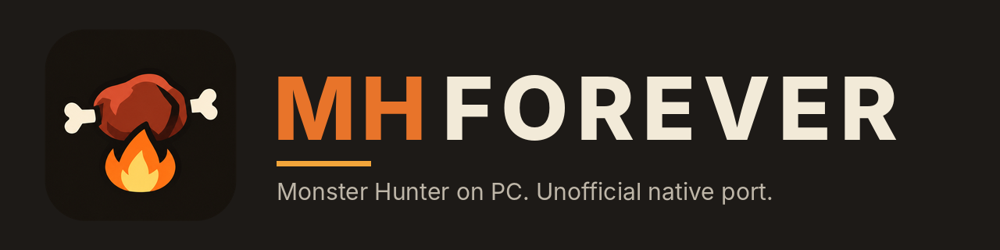

<h1 align="center">
  
</h1>

**PSP Monster Hunter games on PC: an unofficial native port through static recompilation.**

MHForever turns the PSP versions of *Monster Hunter Freedom Unite* and *Monster Hunter Freedom* into native PC programs:
no emulator, any controller, and a launcher that sets everything up from your own disc image. Each game is a module of
its own, and more games of the series are planned.

> Not affiliated with, endorsed by or sponsored by Capcom or Sony. Requires your own legitimate copy of the game.
> No game assets are included or downloaded: no disc image, textures, models, audio, text or saves. "Monster Hunter" is
> a trademark of its owner and is used here only to describe which games the project works with.

Website: **https://mango77x.github.io/MHForever-site/** · Discord: **https://discord.gg/6xrxY2buDf** (bring your own
copy of the game; no piracy talk) · Bugs: [issues](https://github.com/Mango77x/MHForever/issues)

## Supported games

| Game | Release | Status |
|---|---|---|
| **Monster Hunter Freedom Unite** | Europe (`ULES01213`, v1.01), North America (`ULUS10391`, v1.01) | **Playable** |
| Monster Hunter Portable 2nd G | Japan (`ULJM05500`, v1.01), also patched with FUComplete v1.4.0 | **Playable** |
| **Monster Hunter Freedom** | Europe (`ULES00318`, v1.01), North America (`ULUS10084`, v1.00) | **Playable** |
| Monster Hunter Portable | Japan (`ULJM05066`, v1.03) | **Playable** |
| Monster Hunter Freedom + Freedom DX | Europe, North America and Japan (original or English), patched with Freedom DX v1.8.6 | **Playable** |
| Other Monster Hunter games | PSP, later PS2 | Planned, see the [roadmap](docs/10-roadmap.md) |

Single player can be played from start to finish. It is still early software: expect rough edges, and reports are
welcome.

## Features

- **Frame rate**: 30 fps as on the PSP, or 60 to 180 fps with frame interpolation (heavy scenes may not hold the top rates).
- **Resolution** up to 10 times the PSP's, **widescreen** for wide windows and screens, and an optional smoother texture filter.
- **HD text** by default, or any `.ttf`/`.otf` font of your own.
- **HD texture packs** made for PPSSPP (such as KHD), one per copy of the game. None is included.
- **Projected shadows**, **HUD scale** down to 50%, and optional extras such as the analog camera, the mouse camera,
  a fast supply box and true weapon values (Freedom Unite).
- **Online play** (Freedom Unite, experimental) on the PSP ad hoc servers PPSSPP uses, with other copies of MHForever and
  PPSSPP players, plus private rooms with a code and friends added by code.
- **Controllers** work out of the box (tested with a PS5 DualSense); keyboard and mouse too. Buttons can be changed in the
  launcher or the in-game menu (Esc).
- **Windows and Linux** (64-bit), Steam Deck included: the Linux archive carries WebKitGTK, so the launcher opens on
  SteamOS with nothing to install. It is tested on SteamOS's own system in CI, not on a Deck; reports are welcome.

## How to play

1. Download MHForever from the [Releases](../../releases) page and unzip it anywhere (on Linux, see
   [BUILDING.md](BUILDING.md#running-on-linux) for what the launcher needs).
2. Open `MHForever.exe` (Windows) or `MHForever` (Linux) and add **your own** plain `.iso` of the game.
3. The launcher checks your copy and prepares everything from it on your PC. Press **Play**.

Your saves live in `Documents\MHForever\saves` on Windows and `~/.local/share/MHForever/saves` on Linux, outside the
program folder, so updating never loses them. They use the PSP's format: import them from a PSP or PPSSPP in Game
settings, or copy MHForever's into PPSSPP (a save only works with its own release of the game).

**Keyboard:** arrows = D-pad, WASD = analog stick, K/L/J/I = cross/circle/square/triangle, Q/E = L/R, Enter = Start,
Backspace = Select.

## What this is

MHForever is not an emulator. The game's program is **statically recompiled** into native PC code, and the console's
system services are re-implemented. The result is a normal desktop program that runs the game directly, with a modern
launcher around it. That is what makes higher frame rates, any controller and online play practical.

Developed with AI assistance.

## For developers and contributors

Build instructions are in [BUILDING.md](BUILDING.md). Pull requests and bug reports are welcome; every change is reviewed
and merged by the maintainer. See [CONTRIBUTING.md](CONTRIBUTING.md).

| | |
|---|---|
| [Overview](docs/00-overview.md) | [Architecture](docs/02-architecture.md) |
| [PSP platform](docs/03-psp-platform.md) | [Recompiler](docs/04-recompiler.md) |
| [Runtime / HLE](docs/05-runtime-hle.md) | [Freedom Unite module](docs/06-mhfu-module.md) |
| [Freedom module](docs/16-mhf1-module.md) | [Launcher, controllers, Steam Deck](docs/07-launcher-ux.md) |
| [Multiplayer](docs/08-multiplayer.md) | [Private rooms and friends](docs/14-rooms-and-friends.md) |
| [Roadmap](docs/10-roadmap.md) | |

## Special thanks

- **[theguyser](https://github.com/theguyser)**, author of pokke (a port of the Japanese
  release of the same game): the PSP save-data cryptography that lets MHForever read and write saves in the PSP and PPSSPP
  format comes from his project, shared with his permission, along with his time and advice.
- **[sodomon2](https://github.com/sodomon2)**, for the Linux packaging, the desktop integration and the launcher fixes that
  came with them (pull request #7), the keyboard bindings in the launcher (#9), the movies (#12) and the language choice
  (#20).
- **[ibonplix](https://github.com/ibonplix)**, for the first texture pack support (pull request #39): the PPSSPP quick hash, the
  KTX2 decoding and the launcher setting that the HD textures are built on; and for the projected shadows (#90), tuned zone
  by zone across the maps.
- **[Pablo1517](https://github.com/Pablo1517)**, for the hunting horn songs card (pull request #49), the true weapon values
  (#44), keeping the volumes changed in the in-game menu (#45), the fast supply box (#59), browsing the smithy with its
  panels open (#60, with the recompiler's instruction patches) and its improved layout (#62), and the analog camera (#68,
  with the recompiler's call patches), and for the generated region data the game's host reads the region maps through.
- **[SilverJolteon](https://github.com/SilverJolteon/FreedomDX)**, whose Freedom DX patch for Freedom (options, event quests, fixes) MHForever
  runs as its own copy of the game: the player patches their own European, North American or Japanese image with Freedom DX's xdelta and chooses its
  FDXDAT folder in Game settings. Nothing of Freedom DX is included.
- **[The FUComplete team](https://fucomplete.github.io)** ([FUComplete/Patch](https://github.com/FUComplete/Patch)), whose fan patch for the Japanese release (its English translation, events and options) MHForever
  runs as its own copy of the game: the player patches their own image with FUComplete's tool, and the launcher sets its
  options.
- **[Kaneda](https://github.com/sh0t4r0)** (creator of KHD), for the HD text MHForever ships (the game's character map at 16 times its size and every character of
  the font, accents and Japanese included, at 8 times), and for the texture pack ideas.
- **Mobilozor**, for proving HD texture packs on MHForever first (on SteamOS), and for the audit and
  test logs shared with the project.
- **[TeamGDB's Yakumo](https://github.com/TeamGDB/Yakumo)** (MIT), whose frame interpolation MHForever's is ported from, and
  whose texture packs showed how to load them without holding the game up.
- **[PSPRecomp](https://github.com/jessicanataliagta/PSPRecomp)**, the static recompiler framework this project is built on.
- **[PPSSPP](https://github.com/hrydgard/ppsspp)**, for the executable decryption, the texture pack format, as the reference for how the PSP behaves, and for the
  ad hoc online play its players keep alive: MHForever plays on the same servers, and the launcher's list of servers comes
  from the one PPSSPP publishes.
- **[FFmpeg](https://ffmpeg.org)**, whose libavcodec decodes the movie pictures and sound and the game's music.
- **[Kethen](https://github.com/Kethen)**, for [aemu_postoffice](https://github.com/Kethen/aemu_postoffice), the client and the
  protocol that PSP ad hoc servers speak, which MHForever's online play uses (GPL-3.0, included unmodified,
  with [ENet](https://github.com/zpl-c/enet), MIT).
- **The volunteers who run the PSP ad hoc servers** for the PPSSPP community, and in particular those MHForever lists:
  Socom (socom.cc), Madness Gaming Network (psp.mgn.pub), Games Nexus (adhoc.gamesnexus.ovh), Psi-Hate (psi-hate.com)
  and Neko PSP (cat.wjg.jp).
- **[tclamb/mhp2g-decomp](https://github.com/tclamb/mhp2g-decomp)**, the matching decompilation of *Monster Hunter Portable 2nd G*,
  whose documented formats and names helped a great deal.
- Everyone who tested the releases and reported problems on GitHub, Reddit and Discord.

The full list of third-party code and its licenses is in `THIRD_PARTY.md`.

## License

GPL-3.0-or-later (see `LICENSE`). Third-party components keep their own licenses (see `THIRD_PARTY.md`).
