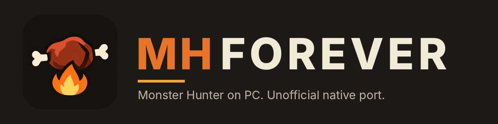

<h1 align="center">
  
</h1>

**Monster Hunter Freedom Unite on PC: an unofficial native port through static recompilation.**

MHForever turns the PSP version of *Monster Hunter Freedom Unite* (*Monster Hunter Portable 2nd G* in Japan, MHFU) into a
native PC program: no emulator, any controller, and a launcher that sets everything up from your own disc image.

**Right now only *Monster Hunter Freedom Unite* (European release) is supported. More games are planned**: MHForever is
the first step of a wider Monster Hunter recompilation project, and each game is a module of its own.

> Not affiliated with, endorsed by or sponsored by Capcom or Sony. Requires your own legitimate copy of the game.
> No game assets are included or downloaded: no disc image, textures, models, audio, text or saves. "Monster Hunter" is
> a trademark of its owner and is used here only to describe which games the project works with.

## Website

**https://mango77x.github.io/MHForever-site/**

The project website explains what MHForever is, shows which games are supported, and always links to the latest
release. It is built from its own repository,
[MHForever-site](https://github.com/Mango77x/MHForever-site). The downloads, the code and the issues live here.

## Community

Questions, bug reports, suggestions and release news: **https://discord.gg/6xrxY2buDf**. Bring your own copy of the game; there is
no piracy talk there. Bugs can also be reported as [issues](https://github.com/Mango77x/MHForever/issues).

## Supported games

| Game | Original platform | Release | Status |
|---|---|---|---|
| **Monster Hunter Freedom Unite** | PSP | Europe (`ULES01213`, v1.01) | **Playable** |
| Monster Hunter Freedom Unite | PSP | US and Japan | Planned |
| Other Monster Hunter games | PSP, later PS2 | | Planned, see the [roadmap](docs/10-roadmap.md) |

Only the first row works today. The others are plans, not promises: they are listed so you know where the project is going.

## Where the project is today

| | |
|---|---|
| **Playable game** | **Monster Hunter Freedom Unite** (PSP), European release (`ULES01213`, v1.01). It is the only game for now. |
| **Frame rate** | **30 fps** as on the original console, or **60 to 180 fps** (any multiple of 30) with frame interpolation, chosen in the launcher Settings. Experimental: heavy scenes may not hold the top rates. |
| **Online play** | Not available yet. **Multiplayer over the internet is being designed and built**, so you can hunt with friends without a PSP. |
| **Platforms** | Windows (64-bit). Linux and Steam Deck are planned. |
| **Controllers** | Gamepads work out of the box. **Tested with a PS5 DualSense**; other pads recognized by SDL should work too. Keyboard defaults included. |
| **Saves** | Kept in `Documents\MHForever\saves`, one folder per game; settings in `%APPDATA%\MHForever`. Updating never loses them. Saves use the PSP format: import them from a PSP or PPSSPP in Settings (your own version of the game), or copy MHForever's into PPSSPP. |
| **Resolution** | Up to several times the original 480x272, with an optional smoother texture filter. |
| **Other games and regions** | The US and Japanese releases of Freedom Unite, and other games of the series, are planned. |
| **Latest release** |   See the [Releases](../../releases) page. |

It is early software: according to the maintainer's testing, single player can be played from start to finish, but expect rough edges and bugs. Reports are welcome.

## How it works for a player

1. Download MHForever from the [Releases](../../releases) page and unzip it anywhere.
2. Open `MHForever.exe` and add **your own** `.iso` of Freedom Unite (a plain, uncompressed image of your UMD).
3. The launcher checks your copy and prepares everything it needs from it on your PC. You can also let it keep a copy
   of your image in its own folder.
4. Press **Play**.

The game's assets (graphics, audio, text, data) are never included in MHForever or sent anywhere: they are read from the
image you provide.
Your saves live in `Documents\MHForever\saves` (one folder per game), outside the program folder, so updating never loses them. Any controller recognized by SDL should work (tested with a PS5 DualSense); there are keyboard defaults too.

**Keyboard:** arrows = D-pad, WASD = analog stick, K/L/J/I = cross/circle/square/triangle, Q/E = L/R, Enter = Start,
Backspace = Select.

## What this is

MHForever is not an emulator. The game's program is **statically recompiled** into native PC code, and the console's
system services are re-implemented. The result is a normal Windows program that runs the game directly, with a modern
launcher around it. That is what makes things like higher resolutions, any controller and, later, online play practical.

Developed with AI assistance.

## For developers and contributors

Build instructions are in [BUILDING.md](BUILDING.md). Pull requests and bug reports are welcome; every change is reviewed and merged by the maintainer. See
[CONTRIBUTING.md](CONTRIBUTING.md).

| | |
|---|---|
| [Overview](docs/00-overview.md) | [Architecture](docs/02-architecture.md) |
| [PSP platform](docs/03-psp-platform.md) | [Recompiler](docs/04-recompiler.md) |
| [Runtime / HLE](docs/05-runtime-hle.md) | [Freedom Unite module](docs/06-mhfu-module.md) |
| [Launcher, controllers, Steam Deck](docs/07-launcher-ux.md) | [Multiplayer](docs/08-multiplayer.md) |
| [Roadmap](docs/10-roadmap.md) | |

## Special thanks

- **[theguyser](https://github.com/theguyser)**, author of pokke (a port of the Japanese
  release of the same game): the PSP save-data cryptography that lets MHForever read and write saves in the PSP and PPSSPP
  format comes from his project, shared with his permission, along with his time and advice.
- **[PSPRecomp](https://github.com/jessicanataliagta/PSPRecomp)**, the static recompiler framework this project is built on.
- **[PPSSPP](https://github.com/hrydgard/ppsspp)**, for the executable decryption and the ATRAC decoders used here, and as the
  reference for how the PSP behaves.
- **[tclamb/mhp2g-decomp](https://github.com/tclamb/mhp2g-decomp)**, the matching decompilation of *Monster Hunter Portable 2nd G*,
  whose documented formats and names helped a great deal.
- Everyone who tested the releases and reported problems on GitHub, Reddit and Discord.

The full list of third-party code and its licenses is in `THIRD_PARTY.md`.

## License

GPL-3.0-or-later (see `LICENSE`). Third-party components keep their own licenses (see `THIRD_PARTY.md`).
